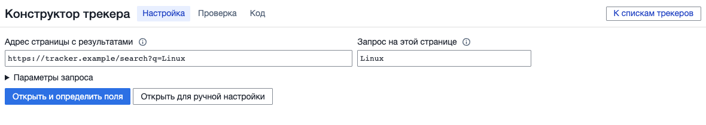
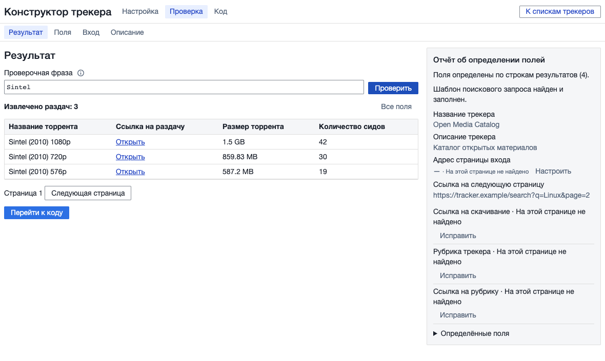
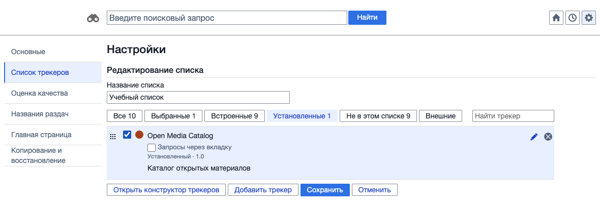

# Как добавить свой трекер в TMS

Если нужного сайта нет в списках, его можно подключить через конструктор. Вы покажете расширению страницу с результатами поиска, а конструктор попробует определить, где на ней находятся названия раздач, ссылки и другие данные. Настройки можно скачать в файле JSON и добавить в свой список трекеров. Для начала достаточно уметь искать на самом сайте и копировать адрес страницы.

В примере используется вымышленный сайт **Open Media Catalog**. Вместо адреса `tracker.example` подставляйте адрес своего трекера.

## 1. Найдите раздачи на сайте

Откройте сайт в Chrome и выполните поиск по запросу, который точно даёт несколько результатов. Если сайт показывает выдачу только после входа, сначала войдите на самом сайте.

Скопируйте из адресной строки **адрес страницы с результатами** и запомните, что ввели в поиск. В нашем примере мы ввели `Linux` и получили страницу `https://tracker.example/search?q=Linux`.

## 2. Дайте конструктору пример

1. Откройте главную страницу или результаты поиска TMS. Нажмите кнопку с карандашом рядом со списком трекеров и выберите **«Открыть конструктор трекеров»**.
2. В поле **«Адрес страницы с результатами»** вставьте скопированный адрес. В поле **«Запрос на этой странице»** введите исходный запрос. В примере это `Linux`.
3. Нажмите **«Открыть и определить поля»**. После обработки посмотрите, какие поля нашёл конструктор.

## 3. Проверьте другой запрос

В разделе **«Проверка» → «Описание»** задайте название, которое будете видеть в списке трекеров, и проверьте адрес сайта. Например, название **Open Media Catalog** и адрес `https://tracker.example/`.

Перейдите в **«Результат»**. Введите в поле **«Проверочная фраза»** другой запрос, по которому сайт тоже что-то находит, и нажмите **«Проверить»**. В примере мы заменили `Linux` на `Sintel`, и в таблице появились раздачи с фильмом Sintel.

Сверьте названия и ссылки с выдачей сайта. Если видны размер и число сидов, проверьте и их. Кнопка **«Все поля»** покажет остальные столбцы. Если у сайта несколько страниц, нажмите **«Следующая страница»** и убедитесь, что появились другие раздачи. На последней странице кнопка должна исчезнуть.

## 4. Сохраните и подключите трекер

1. В конструкторе нажмите **«Перейти к коду»**, затем **«Создать JSON»** и **«Скачать JSON»**. Для трекера, которым будете пользоваться сами, поле **«Адрес файла JSON»** в разделе публикации можно оставить пустым.
2. Вернитесь в список трекеров и нажмите **«Добавить трекер»**. В открывшемся редакторе выберите **«Импортировать файл»**, укажите скачанный JSON и нажмите **«Сохранить»**.
3. Вернитесь к редактированию нужного списка. Откройте фильтр **«Установленные»**, отметьте галочкой новый трекер и нажмите **«Сохранить»** под списком.
4. Откройте поиск TMS, выберите этот список и повторите запрос, который проверяли в конструкторе. Раздачи должны появиться в обычных результатах поиска.

Чтобы вернуться к настройке позже, откройте в конструкторе **«Код» → «Импортировать JSON»** и вставьте содержимое скачанного файла.

## Если что-то не получилось

### Конструктор не видит выдачу

- **Вставлен адрес главной страницы, страницы входа или отдельной раздачи.** Повторите поиск на сайте и скопируйте адрес вкладки, где уже виден список раздач. Введите ту же фразу, что использовали на сайте.
- **Конструктор показывает форму входа или пустую страницу, хотя в Chrome видны раздачи.** Войдите на сайт в том же Chrome. В конструкторе откройте **«Настройка» → «Параметры запроса»**, включите **«Запросы через вкладку»** и повторите определение полей. Этот режим позволяет использовать текущий вход на сайт.
- **Сайт недоступен или показывает проверку браузера.** Откройте сайт в обычной вкладке и проверьте, работает ли поиск там. Если в предпросмотре конструктора есть только пустая оболочка, сайт может подгружать выдачу отдельным запросом. Такую страницу автоматическая настройка может не разобрать.

### Поля определились с ошибками

- **Вместо названия раздачи показана рубрика или открывается неправильная ссылка.** Нажмите **«Исправить»** рядом с полем или откройте **«Проверка» → «Поля»**. Нажмите **«Выбрать»** у нужного поля и щёлкните по подходящему элементу на предпросмотре. Например, для названия и ссылки часто подходит кликабельный заголовок раздачи. Если предпросмотр свёрнут, откройте его кнопкой **«Страница трекера»**.
- **В таблицу попал заголовок или соседняя строка.** Проверьте **«Селектор строки результата»**. В предпросмотре должна выделяться одна повторяющаяся строка на каждую раздачу. Если выделяется и заголовок таблицы, можно пропустить первую строку через поле **«Сколько строк пропустить в начале»**.
- **Размер, дата или число сидов отличаются от сайта.** Сначала проверьте, выбрана ли нужная колонка, а затем посмотрите её **«Преобразования»**. Если сайт совсем не показывает необязательное поле, оставьте его пустым. Для первого рабочего поиска важнее правильно извлечь название и ссылку.
- **Сломаны русские буквы.** В **«Параметрах запроса»** проверьте поле **«Кодировка ответа»**. Например, у старого сайта это может быть Windows-1251. Если страница читается нормально, но именно русские запросы возвращают пустую выдачу, проверьте поле **«Кодировка поискового запроса»**.

Если автоматический выбор совсем не подходит, вернитесь в **«Настройку»**, нажмите **«Открыть для ручной настройки»** и задайте поля на предпросмотре. После правок снова нажмите **«Проверить»**.

### Другой запрос даёт те же результаты или не открывается следующая страница

- **Выдача не меняется при смене фразы.** Конструктор мог сохранить исходный запрос как часть адреса. Сначала проверьте, что в поле **«Запрос на этой странице»** указана точная исходная фраза, и повторите определение полей. В параметрах запроса место, куда подставляется новая фраза, обозначается `%search%`. Например, если сайт принимает параметр `q`, вместо `q=Linux` укажите `q=%search%`. У некоторых сайтов запрос находится в теле POST, поэтому одного адреса страницы может быть недостаточно.
- **«Следующая страница» открывает первую, предыдущую или последнюю страницу.** В разделе **«Поля»** проверьте правило **«Ссылка на следующую страницу»**. Оно должно указывать на переход вперёд. Если сайт в конце выдачи оставляет только кнопку «Назад», правило не должно её захватывать.

### JSON не создаётся или трекер не появился в поиске

- **Кнопка «Создать JSON» недоступна.** Вернитесь в **«Проверку»**, исправьте ошибки, отмеченные как блокирующие экспорт, и запустите проверку заново. После изменений настроек прежний результат проверки может устареть.
- **Файл загружен, но трекера нет в выдаче.** Проверьте, что вы импортировали JSON в редактор через **«Добавить трекер»**, сохранили его, отметили трекер в нужном списке и сохранили список. В обычном поиске выберите именно этот список.

Для более сложных случаев есть [техническое руководство по проверке трекеров](development.md#проверка-и-ремонт-трекеров).
